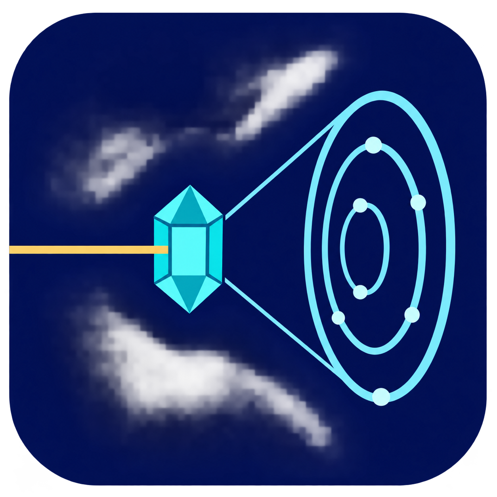
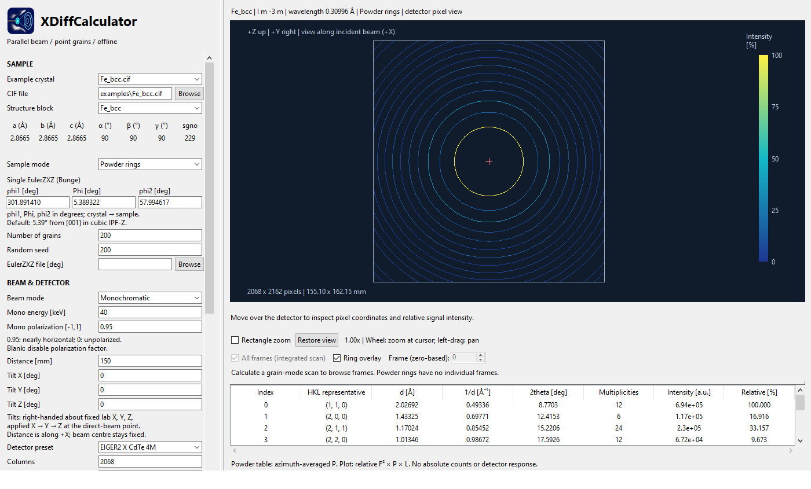
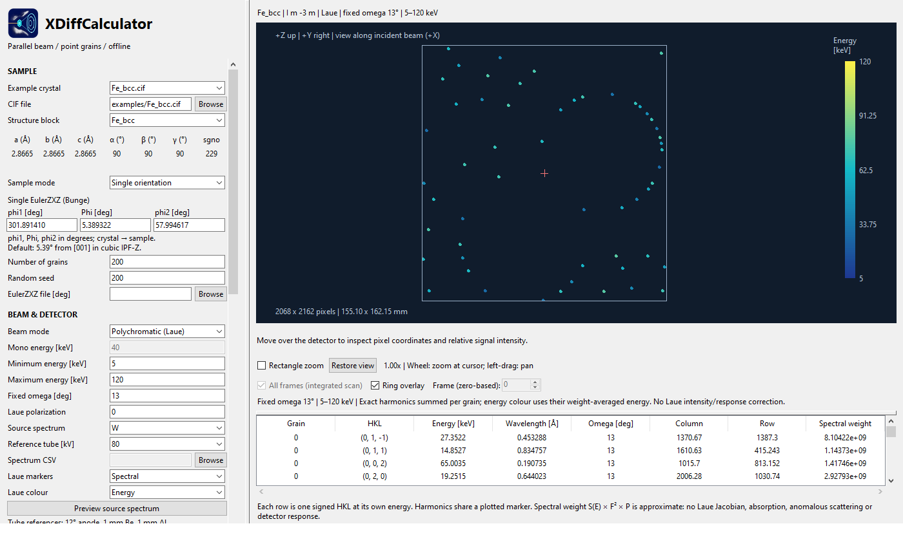

# XDiffCalculator



An offline Windows application for simulating X-ray powder diffraction rings and diffraction spots from polycrystals.

**Author:** Haixing Fang  
**Contact:** haixingfang868@gmail.com

Use a CIF structure, X-ray energy and detector geometry to calculate reflections and visualize their positions and relative intensities. The incident beam is parallel, and all grains are located at the sample origin.

## GUI preview



The screenshot shows the bundled Fe bcc example at 40 keV with an EIGER2 X CdTe 4M detector, a detector distance of 150 mm and zero detector tilt. Ring colours indicate relative calculated intensity.

## Features

- CIF selection with lattice parameters and space-group number (`sgno`).
- Monochromatic rotation scans or fixed-omega polychromatic (Laue) snapshots.
- Laue energy filtering, single/imported/random orientations, W/Cr/Cu reference tube spectra or CSV import.
- Energy-coloured Laue spots, harmonic-aware hover/details, spectrum preview and per-HKL CSV export.
- Powder rings, uniformly random grain orientations, or imported Bunge ZXZ Euler angles in degrees.
- Detector presets, custom pixel geometry and three detector tilt angles.
- HKL table with zero-based index, d spacing, reciprocal spacing, multiplicity and relative intensity.
- Structure-factor, polarization and geometry-dependent Lorentz factors.
- Omega scans with integrated or individual-frame views.
- Resizable panels, rectangle zoom, mouse-wheel zoom and left-drag panning.
- Cursor readout of detector coordinates, nearby signal intensity and ring HKL.
- CSV data, Bunge Euler-angle orientation exports, JSON settings and 300-dpi PNG snapshots.

## White-beam / Laue simulation



Choose **Polychromatic (Laue)** under Beam mode. Select **Single orientation**, **Random grains**, or **Imported orientations**. **Single EulerZXZ (Bunge)** accepts three angles `phi1, Phi, phi2` in degrees, in three labelled entries. The default is **301.891410°, 5.389322°, 57.994617°**, placing sample Z about **5.39° from [001]** in a cubic IPF-Z plot. All grains remain at the origin.

The default energy window is **5–120 keV**. Set **Fixed omega** in degrees. Edited or loaded energy limits are preserved when switching modes. Tube voltage remains a separate source setting: for example, a W 80 kV source has no photons above 80 keV even if the accepted band ends at 120 keV. Rotation-scan/frame controls are disabled in Laue mode. Each signed HKL has its wavelength solved analytically: with `g = Rz(omega) U B hkl`, `lambda = -2 gx / dot(g,g)` and `E = 12.3984198433/lambda`. Only positive wavelengths, energies in the inclusive input band and rays intersecting the detector within max 2theta are retained. Detector tilts use the same geometry as monochromatic mode.

Source options:

- Default on a fresh launch: **W (tungsten), 120 kV**, with the **5–120 keV** accepted energy band. User edits and explicitly loaded settings are retained when switching modes.
- **Flat:** constant relative photon spectral density per keV in the selected band.
- **W:** bundled 40/80/120 kV reference tube spectra.
- **Cr, Cu:** bundled 40/50 kV reference tube spectra, respecting the generator's supported voltage range.
- **CSV:** external photon spectral density, for measured tubes or synchrotron beams. Header must be `energy_keV,photon_density`; energies must be positive and strictly increasing; densities finite and nonnegative. Comments beginning with `#` are preserved. Relative densities are allowed, but values must be per keV rather than integrated per bin. Linear interpolation is used, with zero outside the supplied support.

Tube references were generated using **SpekPy 2.5.4**, `casim`, a 12-degree anode angle, 1 mm Be + 1 mm Al filtration, 100 cm on-axis distance and 1 mAs. They contain bremsstrahlung and characteristic lines on 0.05-keV bins. They are reference conditions, not a calibration of your tube. Import CSV for other voltages, filters, take-off angles or sources. The executable needs no SpekPy installation. See [spectrum provenance](spectra/README.md).

**Preview source spectrum** shows current inputs; **Calculate** applies all inputs to the diffraction result. **Uniform** markers show all geometrically permitted harmonic groups, including where a sampled source has zero flux. **Spectral** markers use the approximate weight `S_E(E) * |F|^2 * P`. The default Laue polarization is zero (unpolarized), independently of the monochromatic default. Blank disables the polarization correction.

These weights are **not quantitative Laue intensities or detector counts**: no Laue integration Jacobian, absorption, anomalous scattering, finite mosaic/line profile or detector response is included. The monochromatic rotation Lorentz factor is deliberately not used. The tabulated characteristic-line bins are interpolated; narrow-line weights depend on that binning and should not be interpreted as resolved line profiles.

The table retains every signed HKL and its own energy. Exact harmonics are summed per grain for display. Energy colouring uses the group's weight-averaged energy (arithmetic mean when all weights vanish). Hover lists the contributing HKLs/energies; double-click opens the full list. Contributions from different grains remain separate markers even when they overlap. The energy legend therefore represents a displayed group average, not an energy-resolving detector measurement.

CSV export saves `_laue.csv` with all contributions and `_laue_settings.json` with source samples/comments/hash, actual U matrices, equivalent `euler_bunge_deg` triples, the orientation convention and model assumptions. **Save settings** separately saves reloadable GUI inputs. Fixed-omega Laue powder integration and continuous-rotation white-beam exposures are not implemented. Existing monochromatic powder and scan workflows remain available.

## Run on Windows

Download `XDiffCalculator.exe` from the repository's "dist" folder for Windows x64, or build it from source.

The file produced at `dist/XDiffCalculator.exe` is a standalone **Windows x64** application. It bundles Python, required libraries, detector presets and the example CIF files present at build time. No Python or Conda installation is required to run it. Browse can load additional CIF files without rebuilding.

The Windows executable has been tested locally; validation on another clean Windows machine remains recommended.

## Quick start

The default example crystal is **Ni.cif** (block `Ni`, cubic Fm-3m, space-group number 225).

1. Choose an example CIF or use **Browse**, then select the structure block.
2. Select **Powder rings**, **Random grains**, or **Imported orientations**.
3. Set energy, detector distance, dimensions, pitches, beam centre and optional tilts.
4. For grain modes, set the omega interval and frame width.
5. Press **Calculate**. Input changes take effect only after recalculation.
6. Inspect the result or export data/a PNG snapshot.

Default settings:

| Parameter | Default |
| --- | --- |
| Crystal | Illustrative BCC Fe |
| Sample mode | Powder rings |
| X-ray energy | 40 keV |
| Detector | EIGER2 X CdTe 4M |
| Distance along the beam | 150 mm |
| Detector tilts X, Y, Z | 0°, 0°, 0° |
| Maximum 2θ | 40° |
| Random grain count / seed | 200 / 200 |
| Polarization degree | 0.95 |
| Omega start / end | 0° / 2° |
| Frame width | 0.25° |

The seed makes random orientations reproducible. Keep it fixed when comparing geometries.

## Coordinates and detector tilt convention

The laboratory frame is right-handed:

- **+X:** incident beam propagation.
- **+Z:** vertically upward.
- **+Y:** outward from the synchrotron.
- Positive sample omega rotates around +Z, counter-clockwise viewed from +Z toward the origin.

At zero detector tilt, image columns increase along +Y and rows along −Z. Pixel centres are zero-based. The physical detector edges are at −0.5 and dimension−0.5.

### Detector tilts

**Tilt X**, **Tilt Y** and **Tilt Z** are in degrees. They are right-handed rotations about the **fixed laboratory axes**, applied X first, Y second and Z third:

`R = Rz(tilt_z) Ry(tilt_y) Rx(tilt_x)`

This convention is defined by this application; angles from another geometry package must be converted if that package uses a different rotation order, pivot or axis convention.

The pivot is the direct-beam point `P = (D, 0, 0)`, where **D is the distance along +X**, not the perpendicular distance to the tilted plane. The specified beam-centre pixel stays at P even when the detector tilts.

For pixel column c and row r:

```text
u = R (0, 1, 0)       # increasing-column direction
v = R (0, 0, -1)      # increasing-row direction
n = R (1, 0, 0)       # detector normal

Q(c,r) = P + (c-cx) py u + (r-cy) pz v
```

Here py and pz are pixel pitches in mm, and cx/cy are the beam-centre coordinates. For a ray s from the sample origin, its plane intersection is `t s`, with `t = (n·P)/(n·s)`. Projection onto u/v gives the detector pixels.

Both powder rings and grain spots use this ray-plane intersection. Powder curves are displayed as clipped segments sampled in laboratory azimuth. Hover intensity also uses laboratory azimuth. Detector tilt does not change the Bragg omega solutions or the physical P/L factors for a reflection that remains on the detector.

The application rejects non-finite angles, edge-on/back-facing planes, and geometries placing any detector corner at X ≤ 0. Older settings files without tilt keys load with zero tilt. Applying a detector preset changes dimensions/pitches and recentres the beam, while retaining distance and tilts.

## Detector presets

All dimensions are columns × rows.

| Detector | Image size | Pixel pitch [µm] |
| --- | --- | --- |
| PILATUS3 R 1M (Si) | 981 × 1043 | 172 |
| EIGER2 1M (Si) | 1028 × 1062 | 75 |
| EIGER2 X CdTe 4M | 2068 × 2162 | 75 |
| EIGER2 X CdTe 16M | 4148 × 4362 | 75 |
| marana_20x_0.55um | 2048 × 2048 | 0.55 |
| marana_10x_1.1um | 2048 × 2048 | 1.1 |
| marana_7.5x_1.47um | 2048 × 2048 | 1.47 |
| marana_5x_2.2um | 2048 × 2048 | 2.2 |
| Hamamatsu_2x_3.25um | 2048 × 2048 | 3.25 |
| CCD_4x_3.362um | 2032 × 2032 | 3.362 |
| CCD_quadro_24um | 2040 × 2040 | 24 |
| Varian_127um | 1456 × 1840 | 127 |

Camera pitches are effective pitches at the detection plane, already accounting for magnification. Detector dimensions include gap coordinates, but inactive module/chip gaps and detector response are not simulated. Manufacturer references are recorded in `detectors.json`.

## Rotation scans and orientations

Rotation controls apply to grain modes. Powder rings average over orientations and do not depend on omega scan settings.

The scan interval is **[start, end)**: start included, end excluded. The default 0–2° scan with 0.25° frames has eight exposures. Frame 0 covers [0,0.25), and frame 7 covers [1.75,2).

Frame width is an angular exposure interval, not numerical search accuracy. Exact Bragg angles are solved analytically and assigned to frames; finite rocking curves are not simulated. A narrow frame may legitimately contain no spots.

- **All frames (integrated scan):** overlays events over the whole scan.
- Uncheck it to inspect one zero-based frame with the arrows or by typing and pressing Enter.
- Overlapping marks are not accumulated into a pixel-count image.

An orientation U maps crystal Cartesian column vectors into the sample frame at omega=0. The reciprocal basis is `B=A^(-T)`, without 2π, with crystal a along +x and b in xy. Scattering uses `g_lab=Rz(omega) U B hkl`.

The input convention is **Bunge intrinsic ZXZ**, in degrees, with angles ordered `phi1, Phi, phi2`. Internally:

```text
U = Rz(phi1) Rx(Phi) Rz(phi2)
```

Here R denotes right-handed active elementary rotations. U maps crystal to sample and is the transpose of the conventional passive Bunge sample-to-crystal matrix, consistent with [MTEX's crystal-to-specimen orientation convention](https://mtex-toolbox.github.io/OrientationDefinition.html). Omega is a separate sample rotation about laboratory Z; it is not included in exported grain orientations.

Orientation CSV/TXT files contain one triple per row, optionally headed:

```text
phi1_deg,Phi_deg,phi2_deg
0,0,0
90,0,0
301.891410,5.389322,57.994617
```

Comma or whitespace separators, blank lines and `#` comments are supported. The header `phi1,Phi,phi2` is also accepted. All angles must be finite, with Phi in [0,180] degrees; phi1 and phi2 are periodic modulo 360. Nine-column matrix files are rejected with an explanatory message.

**Export orientations (EulerZXZ)** saves the calculated grain orientations as equivalent Bunge degree triples, including random-grain orientations. Exported phi1/phi2 lie in [0,360), Phi in [0,180]. At Phi=0 or 180, Euler angles are not unique: phi2 is set to zero and phi1 retains the equivalent rotation. No crystal-symmetry reduction is applied. Export/import preserves the rotation within numerical precision, not necessarily the original angle spelling. Random orientations remain Haar-uniform rotations; Euler angles are not independently sampled uniformly.

The default Euler triple reproduces the earlier near-[001] example: `U.T * [0,0,1]` is approximately `[0.07964636,0.04977897,0.99557949]`. This is an illustrative orientation, not a universal Ni-superalloy orientation. Legacy JSON settings containing `single_u` are converted to Euler angles on load; legacy matrix CSV files must be converted separately.

## Relative intensities and limitations

Wavelength [Å] is `12.398419843320026 / energy [keV]`. Gemmi calculates neutral-atom structure factors using CIF sites, symmetry, occupancies and displacement parameters. Special-position occupancies are handled explicitly.

- Powder table: `I = sum(|F|²) × mean(P) × L_powder`.
- Individual grain event: `I = |F|² × P × L_rotation`, without an extra powder multiplicity factor.
- Coincident powder reflections are grouped. Multiplicities count all signed directions in the group, including accidentally coincident families. CSV preserves all contributing HKLs.

The optional polarization input p is a signed linear polarization degree: +1 horizontal electric field (+Y), −1 vertical (+Z), 0 unpolarized. Default p=0.95. A blank input disables polarization (P=1). With laboratory azimuth χ measured from +Y toward +Z:

```text
P = 1 - sin²(2θ) [1 + p cos(2χ)] / 2
L_powder = cos(θ) / sin²(2θ)
L_rotation = 1 / |sin(2θ) cos(χ)|
```

The full-ring mean P is `[1 + cos²(2θ)]/2`, independent of p. Thus p changes the variation around a ring, while the table reports its full-azimuth mean, not just the detector-visible portion. Powder and rotation Lorentz factors represent different measurement conventions.

Exact rotation tangencies raise an error instead of generating infinite intensities. Near-tangent weights can dominate this ideal model and require finite rocking-profile modelling for quantitative interpretation.

The plot uses a linear 0–100% scale. In grain mode its maximum is fixed across the full detected scan. In powder mode it is the maximum local intensity over the calculated full rings, including portions outside the detector. The table normalizes its mean powder intensities separately.

Intensities are **relative feature weights, not calibrated photon counts**. The model omits anomalous scattering, absorption, solid-angle/pixel response, detector efficiency/gaps, beam divergence/bandwidth, background/noise, texture weights, finite grain shapes, strain, and finite rocking curves. All grains have equal weights and origin positions.

## Plot controls and exports

- Drag the left and bottom dividers to resize the plot relative to controls and the HKL table.
- Enable **Rectangle zoom**, then left-drag a box. After selection, left-drag returns to panning.
- Mouse wheel zooms at the cursor; **Restore view** fits the full detector. Right-drag has no action.
- Hover shows zero-based fractional column/row coordinates and the nearest rendered ring/spot within six screen pixels. Grain-mode ring overlays are guides only.
- The HKL table includes d [Å] and 1/d [Å⁻¹]; the latter is not 2π/d.
- **Export snapshot as png** saves the current canvas at 300 dpi, preserving zoom, pan, frame, clipping, colours and intensity scale. Controls and temporary selection rectangles are excluded.
- CSV export writes signed reflections, grouped powder lines, grain events and a settings JSON file. Raw F², P, L and corrected intensity are retained separately.
- Save/load settings preserves inputs; recalculate after loading.

The display is capped at 20,000 spot marks with explicit preview decimation. PNG and hover reflect the displayed preview; CSV retains every calculated event. Larger computations have explicit workload limits.

## Run from source

Windows with Python 3.12:

```powershell
py -3.12 -m venv .venv
.\.venv\Scripts\python.exe -m pip install -r requirements.txt
.\.venv\Scripts\python.exe app.py
```

Runtime dependencies are Tkinter, Gemmi 0.7.5 and Pillow 12.0.0. PNG text uses Windows system fonts. No NumPy, SciPy, Matplotlib, Qt, ImageD11 or GPU is required. Python 2.7 is not supported by this application's dependency stack.

## Build the standalone executable

From the repository folder:

```powershell
.\.venv\Scripts\python.exe -m pip install -r requirements-build.txt
powershell -ExecutionPolicy Bypass -File .\build_windows.ps1
```

The script creates/replaces **dist/XDiffCalculator.exe** using PyInstaller's one-file mode. Build from the isolated environment. The executable extracts its bundled runtime into temporary storage at startup; it does not require a companion data folder.

`build/` contains temporary build files. `.venv/` contains the local development environment. Neither is for distribution. The executable belongs in GitHub Release assets; `dist/` is intentionally ignored by Git.

## Tests

```powershell
.\.venv\Scripts\python.exe -B -m unittest discover -s tests -v
.\.venv\Scripts\python.exe -B app.py --smoke-test source_smoke.json
.\dist\XDiffCalculator.exe --smoke-test executable_smoke.json
```

Tests cover crystallographic limits, random orientations, diffraction geometry, scan framing, detector tilts, polarization/Lorentz factors and metadata. Tilt tests check axis signs/order, beam-point invariance, pixel/ray round trips, cone intersections, angular coverage and unchanged physical weights for shared reflections.

The smoke test exercises an invisible GUI and checks bundled resources and 300-dpi PNG writing. These checks do not establish experimental calibration. See [VALIDATION.md](VALIDATION.md) for detailed results.

## Project structure

| Path | Purpose |
| --- | --- |
| `app.py` | GUI, calculation orchestration and exports |
| `diffraction.py` | CIF, reflections, structure factors and grain events |
| `laue.py` | Fixed-omega wavelengths, detector hits, harmonic groups and spectral weights |
| `spectrum.py` | Lightweight CSV spectrum validation and interpolation |
| `spectra/` | Bundled tube reference spectra and provenance |
| `tools/generate_spectra.py` | Optional build-only SpekPy reference generator |
| `geometry.py` | Detector geometry, rotations and ray intersections |
| `orientations.py` | Random generation and orientation import/export |
| `snapshot.py` | High-resolution PNG rendering |
| `detectors.json` | Presets and source references |
| `examples/` | Example CIFs and orientation data |
| `assets/` | Application logo, Windows icon and logo-generation prompt |
| `docs/images/` | GUI screenshot used in this README |
| `tests/` | Automated calculation tests |
| `build_windows.ps1` | Standalone Windows build |

Example Fe/Al structures are illustrative rather than certified calibrants. Other supplied CIFs are bundled unchanged; discoverability does not guarantee valid structure data.

## References

- [Gemmi structure factors](https://gemmi.readthedocs.io/en/stable/scattering.html)
- [pyFAI polarization convention](https://pyfai.readthedocs.io/en/latest/api/geometry/)
- [Kabsch (2014): rotation intensities and Lorentz factors](https://journals.iucr.org/d/issues/2014/08/00/dz5332/)
- [Abbondanza et al. (2021): powder diffraction and area detectors](https://journals.iucr.org/j/issues/2021/04/00/kc5126/index.html)
- [PyInstaller operating modes](https://pyinstaller.org/en/stable/operating-mode.html)
